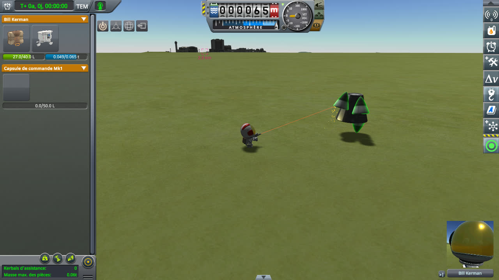

# Construction Laser Fix

**⚠️ Not finished yet.** This is a new fix, not a finished mod. The code and the conclusions on this page can still change.

A fix for stock KSP 1.12, kept as small as possible: one Harmony transpiler, in one source file. It is a mod of its
own, built on top of [KSP Community Fixes](https://github.com/KSPModdingLibs/KSPCommunityFixes), the base most
players run. Here is what it fixes:

> **In a game that is not in English, an engineer never welds in EVA construction mode.** When it attaches a part
> to a vessel, the part is attached, but the engineer does not turn to it, does not lower its visor and does not
> weld it with its laser, and `KSP.log` reads `Kerbal is not an engineer!` at each attach.

**How this was made.** The investigation and the code were written with Claude, Anthropic's AI
assistant. Everything here was reviewed and validated by a human — me. I am saying so up front, because
contributions made with an AI deserve a closer look than others, and because some people would rather
stop reading here. That look should be quick: the stock code involved is named and quoted on this page, the check
below is read in `KSP.log` and on a screenshot of the game, and the fix is one source file you can read in a few
minutes.

## Why it matters

Welding is the reward of EVA construction: the engineer turns to the part it just attached, lowers its visor, and a
laser joins the part to the vessel in a shower of sparks. Every player who runs KSP in any of its languages but
English misses it, on every attach, and the only trace is an error in `KSP.log`.

With this mod, in a French game, Bill, an engineer, attaches a small nose cone to the side of a Mk1 command pod:



*KSP 1.12.5 in French with this mod, with [KSP Community Fixes](https://github.com/KSPModdingLibs/KSPCommunityFixes)
1.41.1, west of the space centre. The construction mode open, the Place tool, a nose cone picked from the stand, then
clicked on the side of the pod. Without the mod, the same gesture attaches the cone, Bill stays still, and `KSP.log`
reads `Kerbal is not an engineer!`.*

To play it yourself, copy [construction-laser.sfs](diag/construction-laser.sfs) into the folder of a sandbox game and
load it: Bill is on EVA five metres from a Mk1 pod standing on three small nose cones.

## The culprit

`KerbalEVA.Weld`, called by `EVAConstructionModeEditor` right after a part is attached to another, only welds when
there is an engineer aboard, which it asks `VesselUtilities.VesselCrewWithTraitCount`:

```csharp
// KerbalEVA.Weld (KSP 1.12)
if (VesselUtilities.VesselCrewWithTraitCount("Engineer") <= 0)
{
    Debug.LogError("Kerbal is not an engineer!");
    return;
}
```

- **The count compares the trait's `TypeName` to `"Engineer"`.** `VesselCrewWithTraitCount` counts the crew whose
  `experienceTrait.TypeName == trait`.
- **`TypeName` is translated.** For a trait of the class `ExperienceTrait` itself, which every stock trait is,
  `TypeName` returns `Config.Title`, the title shown to the player: `"Ingénieur"` in a French game, while the
  internal name, `Config.Name`, is `"Engineer"` in every language, as is `ProtoCrewMember.trait`.
- **So the count is 0 in every language but English,** and `Weld` stops on its error. The part is already attached
  when `Weld` is called: only the welding is lost.

Three other stock methods compare `TypeName` the same way: `VesselUtilities.VesselCrewWithTrait`,
`VesselUtilities.CrewTraitMissionAvailability` (the crew requests of contracts) and `KerbalRoster.SetExperienceTrait`
(its early exit when the kerbal already has the trait asked for). `VesselCrewWithTraitCount` is also how
`EVAConstructionModeEditor` counts the engineers that help lift a heavy part when non-engineers may not, and how
contracts look for a trait aboard.

## The fix

One transpiler, with its switch in [Settings](#settings), on by default. Nothing is saved; removing the mod gives the
stock behaviour back at once.

- **`traitsComparedByName`.** In the four stock methods above, each read of `ExperienceTrait.TypeName` is replaced
  with a call that returns the same value, except for a trait of the class `ExperienceTrait` itself: its internal
  name, `Config.Name`, instead of its translated title. The comparisons then work in every language. A trait of a
  subclass, which only mods define, keeps its class name, as on stock. In an English game, nothing changes: the
  title and the name are the same.

A method that is missing, or that does not read `TypeName` as often as expected, is left as on stock, with a warning
in `KSP.log`.

**Why not change `TypeName` itself.** The crew portrait in flight and the mission summary show it to the player,
and must stay translated.

**Why not patch `KerbalEVA.Weld` only.** It would weld again, but the engineers that help lift a part and the
contracts that ask for a trait would still miss them: the comparison is the defect, not the welding.

## Checked: an engineer attaches a part, in French

A French KSP 1.12.5 with KSP Community Fixes 1.41.1, the save above loaded. The construction mode is opened, the Place
tool picked; a click on one of the stand's nose cones picks it, a click on the side of the pod attaches it there.

- **Without the mod:** the cone is attached, Bill stays still, and `KSP.log` reads `Kerbal is not an engineer!`.
- **With the mod:** Bill turns to the cone, lowers his visor and welds it, as the screenshot above shows; no error in
  `KSP.log`. At startup, the mod writes which stock methods it patched:

```
[KSPFixConstructionLaser] Version 0.1.0.0, traitsComparedByName True, log level Debug
[KSPFixConstructionLaser] [DEBUG] VesselUtilities.VesselCrewWithTraitCount: 1 comparison(s) by internal name
[KSPFixConstructionLaser] [DEBUG] VesselUtilities.VesselCrewWithTrait: 1 comparison(s) by internal name
[KSPFixConstructionLaser] [DEBUG] VesselUtilities.CrewTraitMissionAvailability: 2 comparison(s) by internal name
[KSPFixConstructionLaser] [DEBUG] KerbalRoster.SetExperienceTrait: 1 comparison(s) by internal name
[KSPFixConstructionLaser] Traits compared by name fix installed in 4 stock method(s)
```

## Work in progress

What a player would see if this mod broke something, or what it should fix but was not checked yet, and how to try
it by hand, with the mod and without:

- **Engineers who help lift a heavy part.** With `EVA_CONSTRUCTION_COMBINE_NONENGINEERS = False` in `settings.cfg`
  (it is `True` by default), only engineers near the part add to the mass the construction mode can move. In a
  translated game, on stock, none should count. Put two engineers next to a part too heavy for one, and read the
  count of assisting kerbals in the construction panel.
- **Contracts that ask for a trait aboard.** A contract that wants a scientist, a pilot or an engineer aboard should
  never complete in a translated game on stock, and complete with the mod.
- **Mods that add traits.** A trait defined by a mod as a subclass of `ExperienceTrait` keeps its class name, as on
  stock. A mod trait declared in a `.cfg` only, without a class of its own, is now compared by its name instead of
  its title: a mod that asks for it by name finds it, even when its title differs.
- **Mods that read `TypeName` themselves** are not changed: they still get the translated title.

## Install

Copy the `GameData\KSPFixConstructionLaser` folder into the `GameData` folder of KSP. It needs
[Harmony](https://github.com/KSPModdingLibs/HarmonyKSP), as KSP Community Fixes does.

## Settings

`GameData\KSPFixConstructionLaser\PluginData\settings.cfg` is read once, when KSP starts:

```
// Makes the game recognise a kerbal's trait in every language.
traitsComparedByName = True

// How much the mod writes to KSP.log: Error, Warning, Info or Debug.
logLevel = Info
```

- With `traitsComparedByName = False`, traits are compared by their translated title, as on stock.
- At `Debug`, the mod writes one line per stock method it patched, when KSP starts.

## Build

Set `KSPDIR` to the folder of a KSP install with Harmony in its `GameData`, then run `build.bat`: it
compiles `GameData\KSPFixConstructionLaser\KSPFixConstructionLaser.dll`. Installing is up to you.

## License

[MIT](LICENSE).
